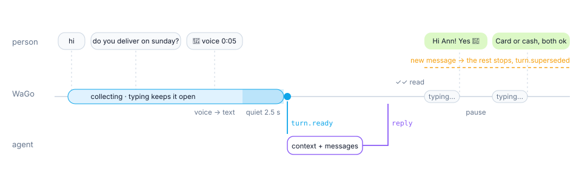

<h1 align="center">WaGo</h1>

<p align="center"><b>Put your AI agent on WhatsApp. It will text like a person.</b></p>

<p align="center">
One tiny Go binary between WhatsApp and your agent. It turns message bursts and voice notes into clean turns,<br>
types replies out like a human, steps aside when you answer from your phone, and never loses a message.
</p>

<p align="center">
<a href="#quickstart">Quickstart</a> ·
<a href="docs/AGENTS.md">How it works</a> ·
<a href="docs/API.md">API</a> ·
<a href="docs/CONFIG.md">Configuration</a> ·
<a href="examples">Examples</a>
</p>

<p align="center">
<a href="https://github.com/nik1t7n/wago/actions/workflows/ci.yml"></a>


</p>

<p align="center"></p>

## The hard part was never the model

Wiring a language model to WhatsApp takes an afternoon. Making it feel right in real chats takes months. People send
three short messages instead of one. They record voice notes. They keep typing while the bot is already answering.
The owner jumps into a chat from their own phone, and the bot talks right over them. A restart drops a reply. A busy
day gets the number banned.

**WaGo is all of that, solved once, in the connector.** Your agent receives one clean event per turn, with the
conversation so far, and answers with one call. Timing, typing, read receipts, retries, ordering, human takeover and
number safety are WaGo's job. Any language, any model.

## What you get

| | |
|---|---|
| 💬 **Turns, not messages** | Bursts, voice notes and typing are gathered into one `turn.ready`. If the person writes again, the turn is superseded and your agent answers everything at once, never half a question. |
| ✍️ **Texts like a human** | Marked read, "typing…" for as long as the words would take, the answer in natural parts with jittered pauses. It stops mid-answer when the person starts a new message. |
| 🙋 **Humans always win** | Answer a chat from your phone and the agent steps back on its own, then returns after a quiet spell. No flags, no keywords, no "pause bot" button. |
| 📮 **Never loses a reply** | A durable outbox survives restarts, retries with the same WhatsApp id so nothing is sent twice, keeps per-chat order, and tells you exactly why anything waits. |
| 🎙️ **Hears and sees** | Voice notes and photos reach your agent as text: Whisper, any vision model, your own service or a local command. Understood once, cached forever. |
| 🛡️ **Keeps the number safe** | Rate and new-chat limits, cold-outreach block, quiet hours, allow and block lists, a kill switch, and an early warning when people start blocking you. |
| 🎬 **Rehearse before you ship** | Run a new agent silently on live traffic, replay a real day of chats at 100x, or script a conversation for your agent's CI. |
| 🔎 **Every message, instantly** | Full history in a local SQLite mirror with full-text search across all chats. Reads in milliseconds, even while offline. |
| 🪶 **Featherweight** | One native Go process, about **21 MB of RAM**. No browser, no Node, no Docker required. Runs on a laptop, a small VPS or right next to your app. |
| 🧰 **Shaped to you** | Every behaviour has a sensible default and can be changed per server, per number and live over the API. |

## Quickstart

### 1. Run it

**Docker:**

```bash
git clone https://github.com/nik1t7n/wago && cd wago
docker build -t wago .
export WAGO_API_KEY=$(openssl rand -hex 24)
docker run -d --name wago -p 127.0.0.1:3000:3000 -e WAGO_API_KEY -v wago-data:/data wago
```

**Binary** (macOS or Linux, Go 1.27 and a C compiler):

```bash
CGO_ENABLED=1 go install -tags sqlite_fts5 github.com/nik1t7n/wago@latest
export WAGO_API_KEY=$(openssl rand -hex 24)
wago
```

### 2. Link your phone

```bash
wago open          # the dashboard opens signed in: scan the QR
```

In WhatsApp: **Settings → Linked devices → Link a device**. Your history starts flowing in right away. Prefer the
API? `POST /api/sessions/default/start`, then `GET /api/default/auth/qr`, or a pairing code with
`POST /api/default/auth/request-code`.

### 3. Your first agent

```bash
python3 examples/python-webhook/agent.py    # listens on :8080; set OPENAI_API_KEY for a real model
```

```bash
curl -X PUT localhost:3000/api/sessions/default -H "X-Api-Key: $WAGO_API_KEY" -H 'Content-Type: application/json' \
  -d '{"config": {"sending": true, "agent": {"enabled": true},
       "webhooks": [{"url": "http://127.0.0.1:8080/", "events": ["turn.ready"]}]}}'
```

Text the number from another phone. Watch it go read, show "typing…", and answer in parts. Sending stays off until
you switch it on, so nothing leaves the number by accident.

> **No phone at hand?** `wago -dev-fake` runs every session on a recording stand-in, and
> `POST /api/{session}/dev/incoming` plays messages, voice notes and typing. The whole loop works, nothing reaches
> WhatsApp.

## One turn, start to finish

<p align="center"></p>

Your agent receives:

```json
{
  "event": "turn.ready",
  "payload": {
    "turn": {"id": "t_3f1c…", "chatId": "15551234567@c.us", "owner": "agent"},
    "context": [
      {"role": "user",  "name": "Ann", "text": "do you deliver on sunday?"},
      {"role": "agent", "text": "Yes, from 10 to 18."},
      {"role": "user",  "text": "hi"},
      {"role": "user",  "text": "[audio] can I pay by card?"}
    ]
  }
}
```

and answers:

```http
POST /api/default/turns/t_3f1c…/reply
{"parts": [{"text": "Hi Ann!"}, {"text": "Yes, card or cash on delivery."}]}
```

That's the whole contract. A `409` means the person wrote again or a human took over: do nothing, the next turn is
already on its way. The full guide: [AGENTS.md](docs/AGENTS.md).

## Plug in any agent

| Path | For | Example |
|---|---|---|
| Webhook + REST | bots and backends in any language | [Python](examples/python-webhook/agent.py) · [TypeScript](examples/typescript-webhook/agent.ts) |
| MCP | Claude, Codex, Cursor and any MCP client | [MCP server](examples/mcp-python/server.py) |
| WebSocket | live dashboards and inboxes | `GET /ws` |

Each example is a complete agent in one file, standard library only (the MCP one adds the official `mcp` package),
and works with any OpenAI-compatible model.

**Coming from WAHA?** WaGo speaks the WAHA API, so existing clients switch by changing the URL. See
[MIGRATION.md](docs/MIGRATION.md).

## Make it yours

Every behaviour has a working default, and each layer overrides only what it names:

```
built-in defaults  <  wago.yaml  <  environment  <  flags  <  per-number config (live, over the API)
```

```yaml
# wago.yaml
processors:
  whisper: {type: transcribe, url: https://api.openai.com/v1, model: whisper-1, apiKey: env:OPENAI_API_KEY}
agent:
  turn: {quietMs: 4000}
  delivery: {charsPerSecond: 18}
  ownership: {handbackMinutes: 60, humanDevices: phone}
  understand: {audio: whisper}
policy:
  enabled: true
  quietHours: {from: "22:00", to: "08:00", timezone: Europe/Berlin, allowReplies: true}
```

[`wago.example.yaml`](wago.example.yaml) lists every field. Secrets are references (`env:`, `file:`, macOS
`keychain:`), never values in a file. Voice and image processing can run fully on your machine with a local command
such as `whisper.cpp`.

## Play it safe

WaGo connects as a linked device of a regular WhatsApp or WhatsApp Business app account, the way WhatsApp Web does.
That makes it an **unofficial client**: WhatsApp's terms do not allow automated or bulk use, and numbers that look
like spam get banned. WaGo is built to behave like a careful person and ships with conservative limits, but no
software can promise an account. Use it for your own number and the people who write to you. **For mass messaging,
marketing or anything at scale, use the official
[WhatsApp Business Platform (Cloud API)](https://developers.facebook.com/docs/whatsapp/cloud-api).**

## Security

- Loopback by default. Put it behind a reverse proxy or a private network before exposing it.
- Every `/api` call needs the key. Keys come from references and never appear in logs or config dumps.
- Webhooks are signed with HMAC-SHA512.
- State is private (0700/0600). `device.db` is the WhatsApp login: keep it safe and backed up.
- Sending is off for every new number until its owner turns it on.

Report vulnerabilities privately, see [SECURITY.md](SECURITY.md).

## Documentation

| | |
|---|---|
| [AGENTS.md](docs/AGENTS.md) | turns, delivery, ownership, outbox, understanding, policy, replays |
| [API.md](docs/API.md) | every route, event and error |
| [CONFIG.md](docs/CONFIG.md) | file, environment, flags, secrets, files on disk |
| [DESIGN.md](docs/DESIGN.md) | why it is built this way, with measurements |
| [MIGRATION.md](docs/MIGRATION.md) | moving an existing WAHA service |
| [CHANGELOG.md](CHANGELOG.md) | versions and API compatibility |

## Development

```bash
go test -race -tags sqlite_fts5 .                        # the whole suite, no account needed
go build -tags sqlite_fts5 -o wago . && ./wago -dev-fake
```

See [CONTRIBUTING.md](CONTRIBUTING.md).

## Roadmap

- MCP built into WaGo, no separate process.
- WhatsApp Cloud API as a second transport behind the same agent layer: start on your app number, move to the
  official API without rewriting your agent.

## License

[Apache-2.0](LICENSE). Built on [whatsmeow](https://github.com/tulir/whatsmeow). WaGo is not affiliated with,
endorsed by or connected to WhatsApp or Meta. "WhatsApp" is a trademark of its owner.
