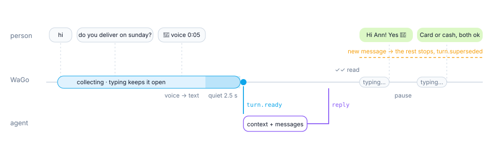

# The agent layer

Connecting a language model to WhatsApp takes an afternoon. Making it behave well in real chats takes months,
because the hard part is not the model, it is the conversation around it. People send three short messages instead
of one, record voice notes, keep typing while the bot is answering, and expect a reply that arrives the way a
person's would. The business owner answers some chats from their own phone and does not want the bot to talk over
them. Messages must not get lost when a process restarts, and the number must not get banned.

WaGo's agent layer handles all of that inside the connector, so an agent receives one clean event per turn and
answers it with one call. Everything below is on with `"agent": {"enabled": true}` in a session's config and works
the same from any language.

<p align="center"></p>

## Turns

A **turn** is everything a person says before they wait for an answer. WaGo gathers incoming messages per chat and
announces the turn once the person has been quiet for `turn.quietMs` (2.5 s). While they are visibly typing it waits
up to `turn.typingGraceMs` more, and it never waits longer than `turn.maxWaitMs` after the first message.

The agent gets one `turn.ready` webhook:

```json
{
  "event": "turn.ready",
  "payload": {
    "turn": {"id": "t_3f1c...", "chatId": "15551234567@c.us", "state": "ready", "messages": ["3EB0..", "3EB0.."], "owner": "agent"},
    "messages": [{"id": "false_15551234567@c.us_3EB0..", "body": "hi"}, {"id": "...", "hasMedia": true, "understanding": "can I pay by card?"}],
    "context": [
      {"id": "...", "role": "user", "name": "Ann", "at": 1795490000, "text": "do you deliver on sunday?"},
      {"id": "...", "role": "agent", "at": 1795490030, "text": "Yes, from 10 to 18."},
      {"id": "...", "role": "user", "at": 1795498000, "text": "hi"},
      {"id": "...", "role": "user", "at": 1795498002, "text": "[audio] can I pay by card?"}
    ]
  }
}
```

and answers it:

```http
POST /api/{session}/turns/{turn}/reply
{"parts": [{"text": "Hi Ann!"}, {"text": "Yes, card or cash on delivery."}]}
```

**The person writes again before the answer.** The turn is closed as `superseded` (`turn.superseded`), its
unanswered messages move into the new turn, and a reply to the old one is refused with 409 and `supersededBy`. The
agent answers everything in one go instead of replying to half a question. A turn nobody answers within
`turn.replyTimeoutSec` expires (`turn.expired`); `POST .../skip` closes one on purpose.

Why turns live in the connector: every serious WhatsApp agent ends up writing a debounce, and most get it subtly
wrong (no typing signal, no carry-over, races between the answer and the next message). The connector sees the
typing indicator and owns the send path, so it is the one place where this can be done correctly once.

## Delivery that reads like a person

A reply is delivered the way someone types on a phone: the turn's messages are marked read after
`delivery.seenDelayMs`, "typing..." shows for as long as the part would take to type (`charsPerSecond`, between
`minTypingMs` and `maxTypingMs`), then the part is sent; the next part follows after `pauseMs`. Every pause has
`jitter` (±30%) so the rhythm is never mechanical. Voice parts show "recording..." instead.

If the person writes during the delivery, it stops before the next part (`outbox.interrupted`, or
`outbox.cancelled` if nothing went out yet) and the new turn carries their message. Set `turn.supersedeOnReply`
to `false` to finish replies regardless.

## The chat belongs to whoever is talking

When someone answers a chat from the owner's phone (or the desktop app, or any other linked device), the chat
becomes theirs: `chat.owner` → `human`. Turns for it stop, a reply in flight stops, queued replies to its turns are
cancelled, and the agent's attempts to answer get 409. After `ownership.handbackMinutes` (30) without the person
writing, the chat returns to the agent by itself.

- `PUT /api/{s}/chats/{chat}/owner {"owner": "human", "minutes": 120}` is the agent escalating ("a colleague will
  answer"); `{"owner": "agent"}` hands it back early; `forever: true` keeps it with people.
- `ownership.whileHuman: "observe"` keeps sending `turn.ready` (with `owner: "human"`) so an agent can suggest
  answers to the operator without sending them.
- `ownership.humanDevices: "phone"` counts only the main phone as a person, for setups where another bot runs on a
  linked device next to WaGo.

WaGo knows which messages it sent itself, so the context marks every line as `user`, `agent` (sent through the
API) or `human` (written by a person on a device). Messages the agent sent never take a chat over.

## The outbox

Every reply goes through a durable outbox in `agent.sqlite3` next to the session. A 202 from the reply endpoint is a
promise: the reply is delivered even if WaGo restarts in the middle of it.

- **Idempotent.** A reply's `id` (or one derived from the turn) never queues twice. Each part's WhatsApp message id
  is derived from the item id, so a retry after a timeout or a crash sends the same id again, and a part already in
  the mirror is not sent again.
- **In order per chat.** Items of one chat are delivered one after another in the order they were queued;
  different chats are delivered in parallel (`outbox.parallel`).
- **Errors by what to do about them**:

| Class | Example | What WaGo does |
|---|---|---|
| `held` | sending is off, kill switch, policy limit, quiet hours, a person owns the chat | waits, retries when it may |
| `transient` | not connected, server hiccup | retries with exponential backoff up to `outbox.maxAttempts` |
| `uncertain` | timed out after the request left | retries with the same message id, which is safe |
| `permanent` | not on WhatsApp, bad address, no permission in the group | fails at once (`outbox.failed`) |
| `policy` | block list, cold outreach | fails at once |

`POST /api/{s}/outbox` queues a message that answers no turn (a reminder, an order update) with the same delivery,
policy and guarantees; `notBefore` schedules it.

## Voice notes and photos as text

Processors turn media into text before `turn.ready` goes out, so the agent reads `understanding` on the message and
`[audio] ...` in the context instead of a file it cannot open. They are declared once in `wago.yaml` and chosen per
session:

```yaml
processors:
  whisper: {type: transcribe, url: https://api.openai.com/v1, model: whisper-1, apiKey: env:OPENAI_API_KEY}
  eyes:    {type: vision, url: https://integrate.api.nvidia.com/v1, model: meta/llama-3.2-11b-vision-instruct, apiKey: env:NVIDIA_API_KEY}
  local:   {type: command, command: [whisper-cli, -m, /models/ggml-base.bin, -nt, -f, "{file}"]}
  mine:    {type: http, url: http://ocr.internal/understand}
agent:
  understand: {audio: whisper, image: eyes}
```

`transcribe` speaks the OpenAI `/audio/transcriptions` API and `vision` the `/chat/completions` API with an image,
so any compatible provider works (OpenAI, Groq, NVIDIA NIM, a local whisper or vLLM server). `http` posts the file
to your service and takes `{"text": ...}` back; `command` runs a local program. Results are cached per message, a
turn waits at most `understand.timeoutMs` for them, and a failure raises `understanding.failed` without holding the
turn back.

## Context

Every `turn.ready` carries the chat's recent history, oldest first, within `context.messages` (20) and
`context.chars` (4000): who said it, when, and the text with media already understood. Most agents need nothing
else to answer in context. `GET /api/{s}/chats/{chat}/context?messages=50&chars=12000` gives a longer window on
demand.

## Protecting the number

WhatsApp bans numbers that behave like spam: many messages to people who never wrote, bursts no person could type,
messages nobody answers. The session's `policy` keeps automated traffic inside human limits:

```yaml
policy:
  enabled: true
  perMinute: 12            # this number's messages, all chats together
  perHour: 200
  perDay: 1000
  perChatPerMinute: 6
  newChatsPerDay: 20       # chats where we write first
  coldOutreach: block      # never write first to someone who never wrote to this number
  quietHours: {from: "22:00", to: "08:00", timezone: Europe/Berlin, allowReplies: true}
  allow: []                # when set, only these chats ("4930*" prefixes work)
  block: []
```

A limit holds the message until it fits (`outbox.held`); a block or cold outreach fails it. Direct sends through the
WAHA routes obey the same policy (429 with the time to retry, 403 for a block). `POST /api/{s}/policy/kill
{"on": true}` stops every send and action at once, for every client of the session.

`GET /api/{s}/policy` shows the signals over the last 24 hours: messages sent, chats started, the share of chats
where the person wrote back, failed sends, and a `risk` of `low`, `elevated` or `high` with the reason. A rising risk
raises `policy.warning`. The thresholds are heuristics drawn from how WhatsApp describes spam, not a guarantee.

## Shadow mode, replays and the simulator

**Shadow mode** (`agent.mode: shadow`) runs everything, turns, timing and policy included, and sends nothing: each
reply ends as `outbox.shadowed` with what would have gone out. Run a new agent in shadow next to the people who
answer today, compare, then switch to `live`.

**Replays** play a chat's real history through a separate engine on a scaled clock (`speed: 60` turns an hour into
a minute). The agent receives `turn.ready` as it would live, with `"replay": "<id>"` in the payload, and answers
through the same endpoint; nothing is ever sent. The timeline puts the agent's answers next to what the person on
the phone actually wrote:

```http
POST /api/default/replays
{"chatId": "15551234567@c.us", "since": 1795400000, "speed": 60, "webhook": {"url": "http://127.0.0.1:8080/"}}

GET /api/default/replays/rp3c9a1f02b4
{"state": "done", "timeline": [
  {"at": 1795400012000, "kind": "inbound", "text": "do you deliver on sunday?"},
  {"at": 1795400015100, "kind": "turn", "turnId": "t_rp3c9a1f02b4_..."},
  {"at": 1795400019800, "kind": "agent", "text": "Yes, from 10 to 18."},
  {"at": 1795400340000, "kind": "human", "text": "yes we do"}]}
```

Each turn sees the real history up to that moment, so every answer is judged against what was really said next.
**The simulator** is the same with a `script` instead of history: `[{afterMs, text, fromMe?}]`. Use it in your
agent's CI to test batching, interruption and timing in seconds. A scaled clock magnifies scheduling noise by the
speed (1 ms at 100x is 100 virtual ms), so keep `speed` well below `quietMs` in milliseconds.

## Writing an agent

The [examples](../examples) are complete agents in one file each: [Python](../examples/python-webhook/agent.py) and
[TypeScript](../examples/typescript-webhook/agent.ts) over the webhook (standard library only, any
OpenAI-compatible model), and an [MCP server](../examples/mcp-python/server.py) that gives Claude, Codex, Cursor or
any MCP client tools to read chats and answer turns. The loop is always the same:

1. Receive `turn.ready` (verify `X-Webhook-Hmac`, answer the webhook at once, think in the background).
2. Decide the parts from `context` (and `messages` for details such as media).
3. `POST /turns/{id}/reply`. A 409 means the person wrote again or a human took over: do nothing, a newer turn
   or a returned chat will come.
